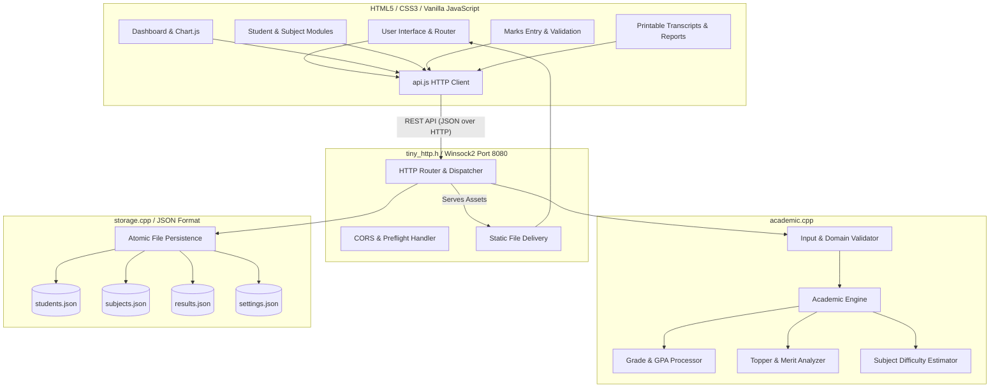
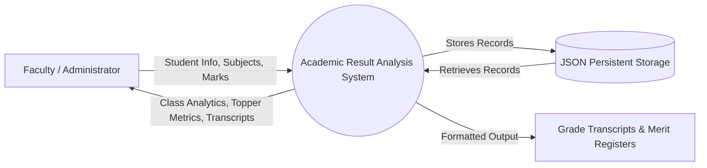
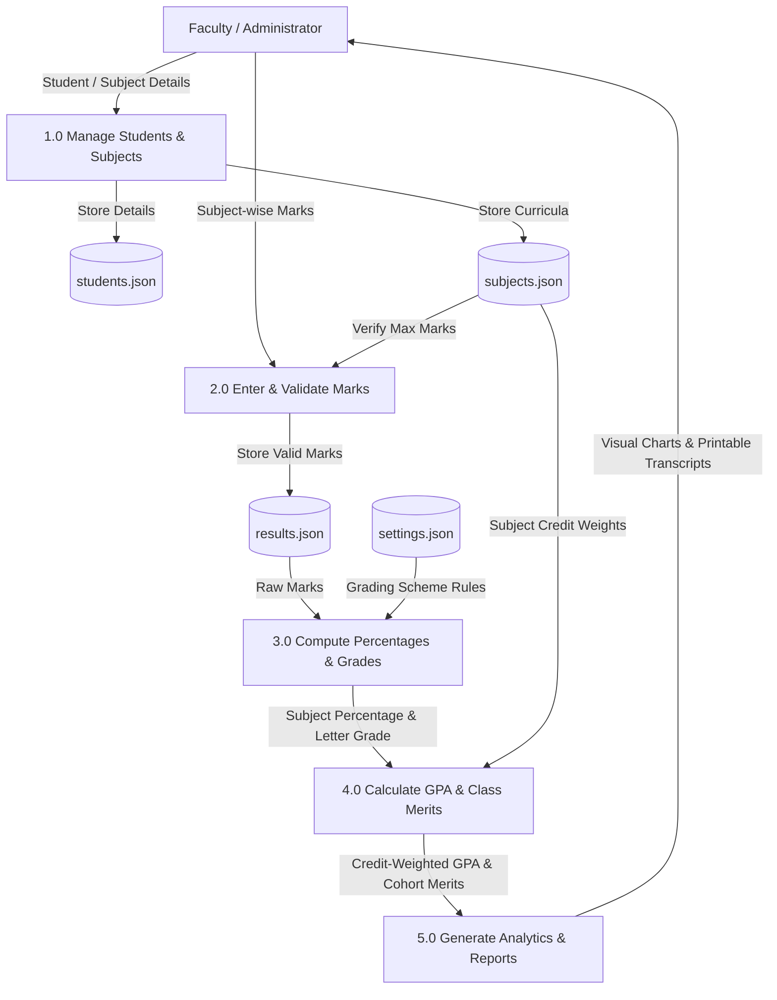

# System Architecture & Technical Design Document

## 1. System Overview

The **Academic Result Analysis System** is engineered as a decoupled client-server architecture consisting of a high-performance C++ backend engine, an embedded Winsock HTTP web server, atomic JSON file storage, and a responsive web application frontend.



---

## 2. Data Flow Diagrams (DFD)

### DFD Level 0 (Context Diagram)



### DFD Level 1 (Detailed Data Flow)



---

## 3. Core Algorithms

### Algorithm 1: Credit-Weighted GPA Calculation

```text
Algorithm ComputeStudentGPA(Student student, List<Subject> subjects, List<Result> results, Settings settings):
    Input: student details, subject list, result records, institutional settings
    Output: StudentReport containing percentage, credit-weighted GPA, and clearance status

    sumWeightedGP <- 0.0
    sumCredits    <- 0.0
    totalObtained <- 0.0
    totalMaximum  <- 0.0
    hasFailure    <- False
    hasMissing    <- False

    For each subject in subjects:
        result <- FindResult(results, student.id, subject.id)
        If result is NULL or result.marksObtained < 0:
            hasMissing <- True
            Continue
        
        If result.isAbsent == True:
            percentage <- 0.0
            grade <- "AB"
            gradePoint <- 0.0
            hasFailure <- True
        Else:
            percentage <- (result.marksObtained / subject.maxMarks) * 100.0
            grade <- LookupGrade(percentage, settings.gradeRules)
            gradePoint <- LookupGradePoint(percentage, settings.gradeRules)
            If result.marksObtained < subject.passingMarks:
                hasFailure <- True

        totalObtained <- totalObtained + result.marksObtained
        totalMaximum  <- totalMaximum + subject.maxMarks
        sumWeightedGP <- sumWeightedGP + (gradePoint * subject.credits)
        sumCredits    <- sumCredits + subject.credits

    If totalMaximum > 0:
        overallPercentage <- (totalObtained / totalMaximum) * 100.0
    Else:
        overallPercentage <- 0.0

    If sumCredits > 0:
        gpa <- sumWeightedGP / sumCredits
    Else:
        gpa <- 0.0

    If hasMissing == True:
        status <- "Incomplete"
    Else If hasFailure == True:
        status <- "Fail"
    Else:
        status <- "Pass"

    Return StudentReport(overallPercentage, gpa, status)
```

---

### Algorithm 2: Empirical Subject Difficulty Classification

```text
Algorithm ComputeSubjectDifficulty(Subject subject, List<Student> students, List<Result> results, Settings settings):
    Input: subject record, cohort students, examination results, system settings
    Output: SubjectStats with statistical parameters and difficulty classification

    completedMarksList <- EmptyList()
    passCount <- 0
    failCount <- 0
    absentCount <- 0

    For each student in students:
        res <- FindResult(results, student.id, subject.id)
        If res is NULL or res.marksObtained < 0:
            Continue // Skip unrecorded entries without biasing average to zero

        If res.isAbsent == True:
            absentCount <- absentCount + 1
        Else:
            completedMarksList.Append(res.marksObtained)
            If res.marksObtained >= subject.passingMarks:
                passCount <- passCount + 1
            Else:
                failCount <- failCount + 1

    If completedMarksList is Empty:
        Return SubjectStats(difficulty = "No Data")

    classAverageMarks <- Sum(completedMarksList) / Length(completedMarksList)
    classAveragePercent <- (classAverageMarks / subject.maxMarks) * 100.0
    passPercent <- (passCount / Length(completedMarksList)) * 100.0

    // Empirical classification based on configured benchmark
    If classAveragePercent < settings.difficultThreshold OR passPercent < 60.0:
        difficulty <- "Needs Attention"
    Else If classAveragePercent >= 75.0 AND passPercent >= 85.0:
        difficulty <- "Easy"
    Else:
        difficulty <- "Normal"

    Return SubjectStats(classAverageMarks, classAveragePercent, passPercent, difficulty)
```

---

## 4. Data Models (C++ Structures)

```cpp
// 1. GradeRule — Individual tier in configurable demonstration grading scheme
struct GradeRule {
    double minPercent;   // e.g. 80.0
    double maxPercent;   // e.g. 89.99
    std::string grade;   // e.g. "A+"
    double gradePoint;   // e.g. 9.0
};

// 2. Settings — Institutional profile & grading policy
struct Settings {
    std::string collegeName;
    std::string department;
    std::string academicYear;
    int currentSemester;
    double passingPercent;
    double difficultThreshold;
    std::vector<GradeRule> gradeRules;
};

// 3. Student — Student identification and cohort affiliation
struct Student {
    std::string id;           // Unique identifier (UUID-based timestamp)
    std::string rollNo;       // Unique institutional roll number
    std::string name;         // Student full name
    std::string className;    // Division or class section
    int semester;             // Current semester (1 to 8)
    std::string department;   // Academic program
    std::string academicYear; // Session
};

// 4. Subject — Curriculum entity with credit weighting
struct Subject {
    std::string id;
    std::string code;         // Course code (e.g., CS501)
    std::string name;         // Course title
    double maxMarks;          // Maximum achievable marks (> 0)
    double passingMarks;      // Minimum clearance threshold
    double credits;           // Credit weight (for GPA calculations)
    int semester;
};

// 5. Result — Performance record mapping student to subject
struct Result {
    std::string id;
    std::string studentId;
    std::string subjectId;
    double marksObtained;     // Recorded score (-1.0 = pending)
    bool isAbsent;            // Examination absence flag
};
```

---

## 5. Persistence & Data Integrity Design

- **Atomic Writes:** All modifications are written to `.tmp` files and committed via atomic rename (`std::rename`), ensuring zero corrupted states during abrupt shutdowns.
- **Sentinel Initialization:** Unrecorded marks are assigned `-1.0` so they never artificially deflate class averages or pass rates.
- **Cascade Cleanup:** Deleting a student or subject automatically cleans up and deletes all orphan result records associated with that entity.
